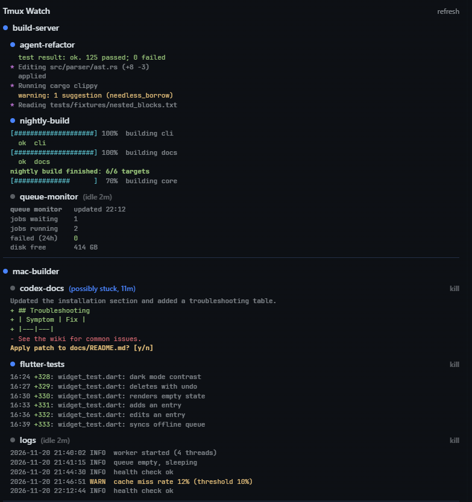

# Tmux Watch

A Hermes Desktop pane that shows **live tmux session state on any number
of SSH-reachable hosts** - without opening a terminal. Read-only by
default, with an explicit opt-in to kill a stuck session per host.

Built for watching a coding agent (Claude Code, Codex, Hermes itself, or
anything else that runs inside a tmux pane) work on a remote dev box: instead
of SSHing in to check "is it still running, did it finish, is it stuck
waiting for a permission prompt", you get a live list of sessions with real
color, a status-bar chip summarizing all of them, and a stall warning when
one hasn't produced new output in 5+ minutes.



The status-bar chip summarises every watched session; here one is flagged:


## What it is, concretely

- **A desktop pane + status-bar chip** (`desktop/plugin.js`): lists every
  configured host, each host's tmux sessions (with real ANSI color from the
  program's own output), a dot (lit = active, dim = idle/waiting for
  input), a "possibly stuck" label when stalled, and the tail of that
  session's scrollback. The chip summarizes everything at a glance without
  opening the pane.
- **A backend** (`dashboard/plugin_api.py` + `dashboard/logic.py`): runs
  wherever your Hermes gateway runs, SSHes out to each configured host.
  Three endpoints: `GET /status`, `GET /config`, and `POST /kill` (see
  below - opt-in, off by default).

The pure logic (config parsing, ANSI sanitizing, stall detection, SSH
execution) lives in `dashboard/logic.py` with **no FastAPI import**, so it's
unit-testable with a plain `python3` - see `tests/test_logic.py` - without
ever touching a live Hermes gateway. `plugin_api.py` is a thin FastAPI
wrapper around it.

## Security disclosure

- The backend shells out to `ssh <host> '<path-prefix> tmux ...'` for each
  configured host.
- `GET /status` runs `tmux list-sessions` and `tmux capture-pane -e` (the
  `-e` captures color codes) - read-only, nothing else on the remote host.
  Every escape sequence except SGR color codes is stripped server-side
  before the text is returned (`dashboard/logic.py::sanitize_ansi_sgr`) -
  this is a security boundary, not cosmetics: a compromised or malicious
  remote process can't use terminal escapes to manipulate the pane beyond
  picking text colors.
- `GET /config` returns host labels/addresses/flags only - never secrets.
- `POST /kill?ssh_host=...&session_name=...` runs `tmux kill-session`. This
  is the one command-executing, state-changing endpoint, and it's refused
  (`{"ok": false, "error": "..."}`) unless the target host has
  `allow_control: true` in `config.json` - **off by default**. The Desktop
  UI only shows the kill button when a host has opted in, but the backend
  re-checks the flag itself on every call; hiding the button is a
  convenience, not the enforcement point (that lives in `plugin_api.py`'s
  `/kill` handler, not duplicated into `logic.py`).
- The config file (`~/.config/hermes-tmux-watch/config.json`) holds **no
  secrets** by design - it only ever needs an SSH host alias, which is
  expected to resolve via your own `~/.ssh/config` (key-based auth, already
  set up outside this plugin). Do not put passwords or tokens in it.
- No network calls other than the SSH connections you configure. No
  telemetry.

## Install

Tmux Watch has two halves, and they can live on different machines:

| Half | What it does | Where it must live |
|---|---|---|
| **Backend** (`plugin.yaml`, `__init__.py`, `dashboard/`) | SSHes to your hosts and reads tmux | The machine running your Hermes **gateway / `hermes serve`** |
| **Pane** (`desktop/plugin.js`) | The UI: pane + status-bar chip | **Every** machine where you run Hermes Desktop |

If Desktop and the gateway are the same machine, that's one place. If Desktop
connects to a remote Hermes (SSH or remote gateway), the backend is installed
once on the server, and the pane once per Desktop machine (laptop, PC, …).
Only the pane is per-device; host config lives with the backend, so every
Desktop shows the same hosts.

### Option A: one-click install (recommended)

In Hermes Desktop, open this link (paste it into your browser's address bar or
click it from any page that allows custom links - GitHub itself does not make
`hermes://` links clickable):

```
hermes://plugin/install?repo=Dofeyna/hermes-tmux-watch&enable=1
```

Or without a link: **Capabilities → Plugins → Install from Git** →
`https://github.com/Dofeyna/hermes-tmux-watch`.

The dialog shows what the repo ships - tick **both** the agent plugin and the
desktop plugin. When Desktop is connected to a remote Hermes, the agent half
goes to that remote machine and the pane to this computer, from the same
dialog.

On a **second Desktop machine** (backend already installed on the server),
run the same install and tick only the **desktop** component.

Then:

1. **Capabilities → Plugins** → make sure *Tmux Watch* is toggled **on**
   (desktop plugins ship opt-in).
2. **⌘K / Ctrl+K → "Reload desktop plugins"**.
3. Add your hosts - see [Configure](#configure).

### Option B: manual install

**On the gateway machine** (backend):

```bash
git clone https://github.com/Dofeyna/hermes-tmux-watch ~/.hermes/plugins/tmux-watch
hermes plugins enable tmux-watch
```

If Desktop runs on this same machine, you are done - Desktop copies the pane
from `desktop/plugin.js` automatically. Toggle it on and reload as above.

**On each other Desktop machine** (pane only):

macOS / Linux:

```bash
mkdir -p ~/.hermes/desktop-plugins/tmux-watch
curl -fsSL https://raw.githubusercontent.com/Dofeyna/hermes-tmux-watch/main/desktop/plugin.js \
  -o ~/.hermes/desktop-plugins/tmux-watch/plugin.js
```

Windows (PowerShell):

```powershell
$root = if ($env:HERMES_HOME) { $env:HERMES_HOME } else { "$env:LOCALAPPDATA\hermes" }
$d = "$root\desktop-plugins\tmux-watch"
New-Item -ItemType Directory -Force $d | Out-Null
Invoke-WebRequest https://raw.githubusercontent.com/Dofeyna/hermes-tmux-watch/main/desktop/plugin.js -OutFile "$d\plugin.js"
```

The folder name must be exactly `tmux-watch`. Desktop's local Hermes folder is
`~/.hermes` on macOS/Linux and `%LOCALAPPDATA%\hermes` on Windows (unless
`HERMES_HOME` is set). Then **Ctrl+K / ⌘K → "Reload
desktop plugins"**. The pane talks to the backend over your existing Desktop
connection - nothing to configure there.

### Troubleshooting

| Symptom | Cause | Fix |
|---|---|---|
| No pane, no chip | Pane file missing on *this* computer (e.g. after reinstalling Desktop) | Re-run Option A (desktop only) or the Option B pane step |
| Plugins page says Desktop half **unavailable (remote backend)** | Backend installed on the server, pane not on this machine | Same as above |
| Pane shows errors / "backend unreachable" | Backend not enabled on the gateway | `hermes plugins enable tmux-watch` on the gateway, then restart it |
| Pane is empty | No hosts configured | See [Configure](#configure) |
| Old version after an update | Each Desktop keeps its own copy of the pane | Re-run the install with *replace* (`&force=1`) or re-download `plugin.js` |

## Configure

Edit `~/.config/hermes-tmux-watch/config.json` **on the machine running the
backend** (the gateway host). A default example is written there
automatically the first time the backend runs if the file doesn't exist yet.

```json
{
  "hosts": [
    {
      "label": "dev-box",
      "ssh_host": "dev-box",
      "remote_path_prefix": ""
    },
    {
      "label": "mac-builder",
      "ssh_host": "mac-builder",
      "remote_path_prefix": "export PATH=\"/opt/homebrew/bin:$PATH\"; ",
      "allow_control": true
    }
  ]
}
```

- `ssh_host`: anything `ssh <ssh_host>` resolves (an alias in
  `~/.ssh/config` is the easiest way; this plugin never handles credentials
  itself).
- `label`: display name in the pane; defaults to `ssh_host` if omitted.
- `remote_path_prefix`: optional shell snippet prepended to every remote
  command. Non-interactive SSH doesn't source `.zshrc`/`.bashrc`, so if
  `tmux` lives somewhere non-standard on that host (e.g. Homebrew on
  Apple Silicon, `/opt/homebrew/bin`), set the `PATH` export here.
- `allow_control`: optional, **defaults to `false`**. Set `true` to let the
  Desktop pane show a confirm-gated "kill session" button for that host's
  sessions. Leave it off for any host where you don't want a UI click to be
  able to terminate a running job.

No restart needed - the backend re-reads the file on every poll.

## Features

- **Live multi-host tmux session list**, polled every 5s.
- **Real ANSI color** from the program's own output (test PASS/FAIL colors
  etc.), sanitized server-side to color-only escape codes.
- **Stall detection**: a session whose last output line hasn't changed in
  5 minutes (configurable via `STALL_THRESHOLD_S` in `logic.py`) is flagged
  "possibly stuck" in the pane and rolled into the status-bar chip.
- **Status-bar chip**: glance at "N/M active" or "⚠ N possibly stuck" across
  every host without opening the pane.
- **Opt-in kill-session**: per-host `allow_control`, confirm dialog in the
  UI, re-checked server-side.

## Limitations / non-goals

- "Possibly stuck" means the screen has not changed for 5 minutes. A session
  that is simply idle (a quiet shell, a log with no new lines) is flagged the
  same way, since the plugin only looks at the screen.
- No "send a command into a session" feature (`tmux send-keys`) - this
  plugin watches and can stop a stuck session, it doesn't drive one. If you
  want that, fork it; it's a deliberate scope cut.
- Polls every 5s per host; not meant for dozens of hosts or sub-second
  freshness.
- Assumes SSH key auth is already working to every configured host. This
  plugin does not manage SSH keys, passwords, or any other credential.

## License

MIT - see `LICENSE`.
